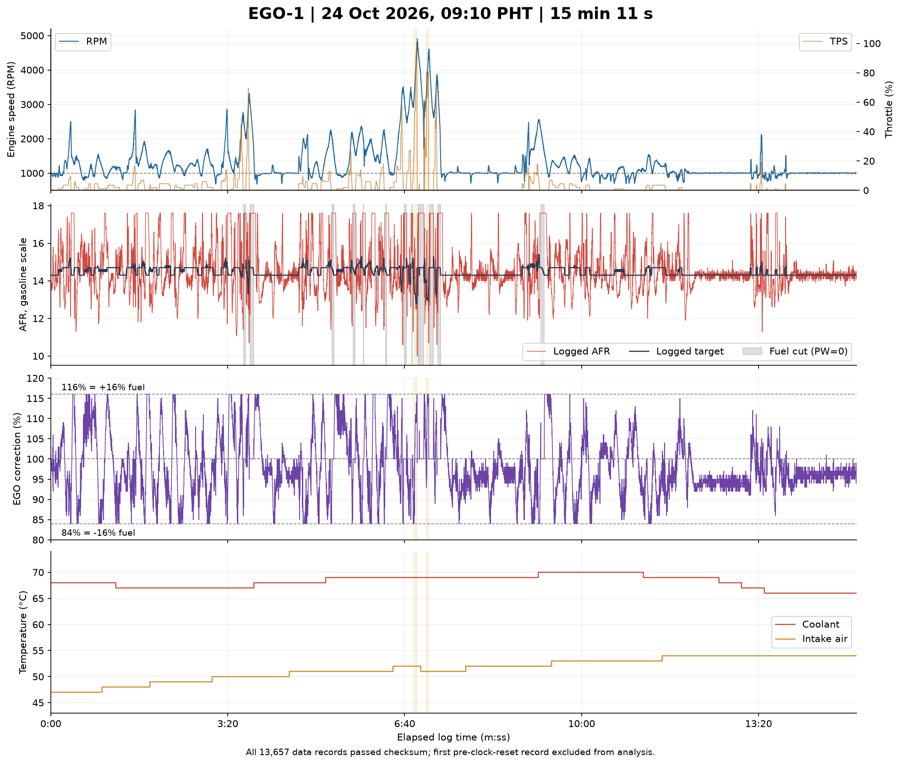
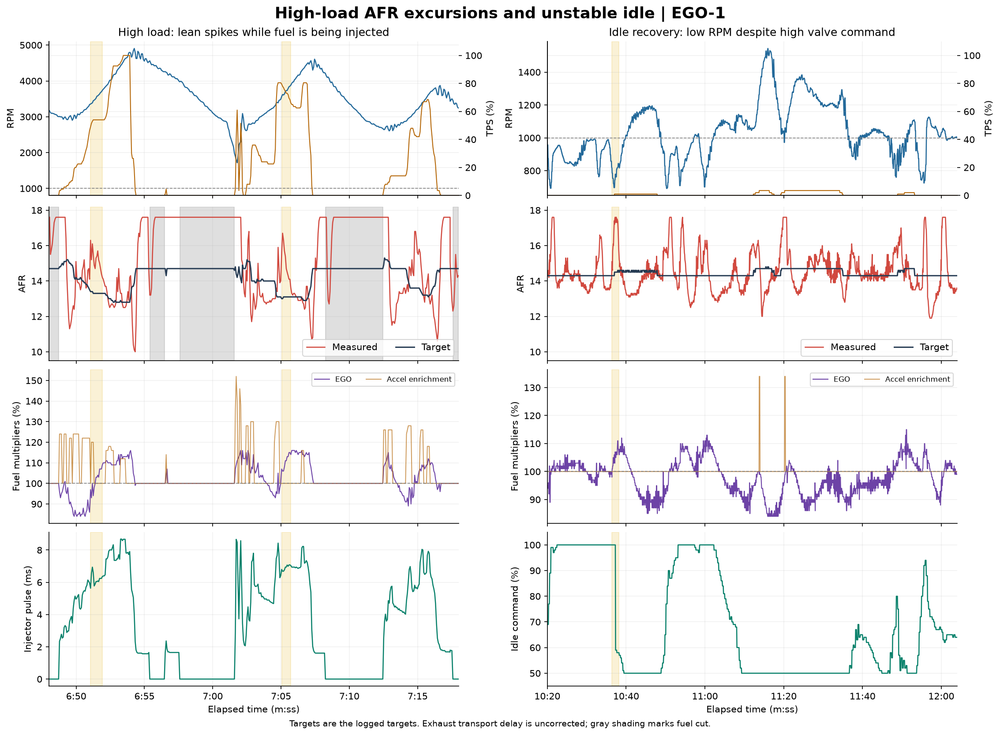

# EGO-1 datalog analysis

Analyzed 24 October 2026. Source: `DataLogs/EGO-1.mlg`, captured approximately **09:10:18–09:25:29 PHT**. Controller signature: Speeduino 2025.01.6. Wideband identified by the owner as **AEM X-Series 30-0300**, configured using the manufacturer's custom linear settings.

**The engine can hold a stable idle near its logged AFR target, but repeated lean excursions during acceleration and unstable idle recovery need investigation before further full-load testing.** EGO correction is active and substantially changes fuel delivery. This log does not establish that the underlying VE table or ignition timing is correct.

No tune, dashboard, project configuration, or ECU setting was changed during this analysis.

## Recorded coverage and data quality

| Item | Finding |
|---|---|
| Valid data records | 13,657; every record passed its byte checksum |
| Analyzed records | 13,656 after removing the initial record with a pre-reset logging clock |
| Duration / sampling | 910.605 seconds, approximately 15 records/second |
| RPM | 679–4,906 |
| Throttle / manifold pressure | 0–100% TPS; 13–92 kPa MAP; barometric pressure 98 kPa |
| AFR / logged targets | 10.0–17.6 measured; 12.8–15.4 commanded |
| Coolant / intake temperature | 66–70°C / 47–54°C |
| Warm-up enrichment | 100% throughout; no additional warm-up fuel multiplier |
| Battery voltage | 12.6–13.4 V, mostly around 13.3 V |
| Injector duty | Maximum logged duty 33.36% |
| Synchronization | Sync-loss counter remained 6 throughout; sync status remained 2 |

This is an already-running engine log, not a cold start. ECU seconds are 122 at entry and wrap through their 8-bit range; those wraps are not evidence of ECU resets. RPM never reaches zero in this capture.

The first record reports logging time 164.147 s, followed by the logging-clock reset to 0.004 s. That first record remains in the decoded export but is excluded from all analysis and plots. Remaining times are nondecreasing; duplicate timestamps are retained. Three binary record-counter discontinuities are recorded in `decode-validation.json`. They do not coincide with checksum failures; the largest observed interval between analyzed records is approximately 0.182 s. These counters alone do not establish lost ECU synchronization or a specific number of missing engine measurements.

## 1. Settled idle is close to target, with modest fuel subtraction

The clearest stable example is **14:00–15:10.6**:

| Channel | Result |
|---|---|
| RPM | 981–1,018; time-weighted mean 1,000 |
| Logged idle target | 1,000 RPM |
| AFR | Mean 14.31; median 14.3; range 13.7–15.1 |
| Logged AFR target | 14.3 |
| AFR within ±0.5 of target | 98.6% of this interval |
| EGO multiplier | Median 96%; about 4% fuel subtraction |
| Idle command | 64–66%, median 65% |
| MAP | 38–39 kPa |

Across the whole log, the defined settled-idle filter retains **276.3 seconds**: mean RPM 1,001, mean AFR 14.29, median EGO 95%, and 87.1% of retained time within ±0.5 AFR of the logged target. This suggests a modest rich bias in base idle fueling under these particular conditions, assuming the wideband calibration is accurate. It does not justify applying a blanket VE reduction: operating conditions change, and the control loop is already compensating.

## 2. Lean acceleration excursions are the highest-priority finding

The following excursions occur with nonzero injector pulse width, open throttle, and high MAP. They are distinct from the closed-throttle fuel-cut periods.

| Elapsed log time | RPM / load | Measured AFR | Logged target | EGO multiplier |
|---|---|---|---|---|
| 6:51.05–6:51.85 | 3,355–3,696 RPM; 49–54% TPS; 89–90 kPa | 14.4–16.3 | 13.3–13.4 | 93–107% |
| 7:05.05–7:05.65 | 3,565–3,853 RPM; 68.5–79.5% TPS; 92 kPa | 14.1–16.7 | 13.0–13.1 | 106–115% |
| 7:14.79–7:15.32 | 3,118–3,386 RPM; 42–63.5% TPS; 89–91 kPa | 14.3–16.8 | 13.3–13.6 | 100–109% |

At 7:05.11 specifically: 3,622 RPM, 78% TPS, 92 kPa MAP, **16.7 AFR against a 13.0 target**, with 106% EGO and a 6.69 ms injector pulse. The peak is brief, but surrounding samples remain above target for roughly two-thirds of a second. It is not just one isolated point.

Later in that pull, measured AFR moves toward 13.1 as EGO reaches 115–116%. The loop is contributing significant extra fuel. This is evidence that the acceleration fueling response needs work; it does not isolate a single bad VE cell or prove fuel-pressure loss.

There are only **1.93 seconds at TPS ≥80%**, spread across three brief intervals, and no records above 4,906 RPM. The capture cannot validate sustained full-load fueling or the upper-RPM map. Its 33.36% maximum injector duty does not suggest duty-cycle saturation in the captured range, but says nothing conclusive about actual fuel pressure, injector flow, or capacity at higher RPM.

**Avoid further full-load pulls until the measured lean excursions are resolved.** If they represent actual lean combustion, operating under load can increase detonation risk. There is no knock evidence in this log with which to establish safe ignition timing.

## 3. Transients and EGO correction interact strongly

The logged EGO multiplier ranges from **84% to 116%**, meaning −16% to +16% fuel correction. It spends approximately **25.6 s at the lower limit** and **27.2 s at the upper limit**. A multiplier of 100% means no EGO adjustment, not proof that feedback is disabled.

The trace alternates between rich excursions, fuel subtraction, throttle opening, and lean excursions followed by added fuel. Acceleration enrichment also switches between its base 100% and values up to 152%. At 6:51.05, for example, acceleration enrichment falls from the previously logged 122% to 100% while AFR reads 16.3; at 7:04.91, enrichment falls from 130% to 100% before another lean excursion. These are useful diagnostic associations, not proof that enrichment duration alone is wrong: exhaust transport delay means AFR reflects earlier combustion, and several variables change together.

The log is consistent with some combination of base-fuel mismatch, enrichment onset/duration, feedback response, and load transitions. It cannot distinguish those from wideband offset, exhaust leakage, misfire, or fuel-system behavior by itself. Increasing EGO authority or applying the peak AFR/target ratio directly to VE would be poorly supported.

The saved tune uses TPS-based fuel load, so fuel-table locations must be discussed as **RPM × TPS**, rather than RPM × MAP. MAP still helps identify real engine load. Do not treat a small ITB throttle percentage as proof of light load: this log reaches ≥80 kPa at throttle openings well below full throttle.

## 4. Idle recovery remains inconsistent

Closed-throttle RPM falls below 850 for **27.0 seconds total** across the capture, with an overall minimum of 679 RPM. Closed-throttle idle command reaches 100% for **43.6 seconds**. A command is not a measurement of valve opening or bypass airflow, particularly with the saved reverse PWM direction.

At **10:36.9**, RPM falls to 697 with TPS 0%, MAP 69 kPa, AFR 17.0–17.4 against a 14.3 target, and idle command 100%. Injector pulse width is approximately 4.4–4.5 ms. At **10:37.1–10:37.3**, TPS becomes 1%, logged ignition advance changes from 24° to 13°, and idle command subsequently drops from 100% to 59% while RPM remains below target.

That sequence makes small-TPS idle eligibility and idle-advance transitions worth checking alongside valve response and TPS stability. The saved tune has a 0% idle TPS limit and 1% idle-advance TPS setting, but it was saved after the log; exact settings during that event are not independently established. The log does not identify whether an accessory load was applied. Lean AFR accompanying the RPM drop does not establish whether fuel shortage caused the drop or combustion instability produced excess exhaust oxygen.

## 5. Fuel cut explains some lean readings; the 17.6 ceiling still needs verification

DFCO is active for **32.1 seconds**, always with logged pulse width zero and TPS zero. Its lean readings should not be used to add fuel to the VE table. AFR can remain lean briefly after fuel resumes because the exhaust measurement is delayed.

Exactly **17.6 AFR** is recorded for **87.4 seconds total**, including approximately 29.0 s during fuel cut and **58.4 s while fuel is being commanded**. This repeated upper plateau is an observed ceiling in the logged channel. The log has neither raw wideband voltage nor AEM sensor-status information, so it cannot establish why that ceiling occurs or whether the actual mixture extends beyond it.

For the AEM 30-0300, the manufacturer's analog relationship is **AFR = 2.375 × volts + 7.3125**, with **0.5 V = 8.5 AFR** and **4.5 V = 18.0 AFR**. AEM specifies the white wire as analog positive and the brown wire as analog negative; for an ECU without a differential input, its manual directs the brown wire to the shared signal ground. These are reference checks, not a verified inspection of this installation. [AEM manufacturer instructions](https://documents.aemelectronics.com/techlibrary_30-0300_x-series_wideband_uego_afr_sensor_gauge.pdf)

The owner's reported custom-linear method is appropriate. Actual numeric calibration points and agreement between the gauge and TunerStudio remain unverified. `std_ms2geno2.log` only contains a calibration-operation header and does not preserve the selected numerical curve. The `.msq` is not evidence of the actual controller-resident wideband lookup table. Speeduino requires the selected sensor/controller transfer function to interpret its input correctly. [Speeduino sensor calibration](https://wiki.speeduino.com/en/configuration/Sensor_Calibration)

## Saved-tune context and evidence limits

`CurrentTune.msq` was saved at **09:30:31 PHT**, after this capture ended. The controller signature matches, but the full saved configuration is not proven identical to the running configuration throughout the log. Logged targets, multipliers, and enrichment values take precedence for this analysis.

The later saved tune contains wideband PID correction, P/I/D 80/30/50, ±16% authority, active above 30°C and 500 RPM, below 100% TPS, and within 20–120 kPa MAP, with a 15-second start delay. It also contains TPS fuel load, disabled AFR incorporation, PWM closed+open idle at 200 Hz, two idle channels, reverse direction, a 50–100% idle-command range, and AFR protection off. The matching ±16% limits are visible in the log, but these other settings must not be assumed to have remained unchanged during capture.

Coolant stays at 66–70°C and intake air at 47–54°C; those are the conditions covered. This is not enough temperature coverage to validate coolant/IAT compensation or diagnose a thermostat. No new sync-loss counts are recorded, but the existing count of six predates the analyzed capture and its cause is not resolved here.

No calibrated fuel-pressure or oil-pressure installation was established. The channels bearing those names must not be treated as physical pressure proof. There is no vehicle-speed channel, measured torque, knock measurement, timing-light verification, or wideband raw-voltage/status channel in this capture.

## Recommended diagnostic order

1. Compare AEM gauge and TunerStudio at settled idle and a safely held light-load condition; verify the entered numeric calibration and investigate the 17.6 plateau if the gauge reads differently. Inspect signal grounding and possible exhaust leaks if readings disagree. Confirm any rough-running event is not a misfire before interpreting its lean reading as a fuel deficit.
2. Establish repeatable fully warmed idle with stable TPS zero and known accessory states. Check physical valve response and eligibility changes around the low-RPM recovery events. Do not infer airflow from 100% command alone.
3. Gather longer steady light-load holds, then assess RPM/TPS fuel-table areas with feedback correction and exhaust delay accounted for. This capture provides only about 24.5 seconds of filtered steady operation above idle, all below approximately 1,520 RPM; it provides no filtered steady data above 1,800 RPM under the stated criteria.
4. Once base fueling and sensor agreement are established, evaluate throttle enrichment and feedback behavior under controlled load. Resolve the lean excursions before expanding to sustained high load. Validate ignition separately using measured timing and knock/torque evidence.

No calibration changes are prescribed from this log alone.

## Method and reproducibility

Decoded the self-describing, big-endian binary file using its embedded field types, scales, and shifts; checked every data checksum and tracked record counters. The parser follows [EFI Analytics MLVLG v2 specification](https://www.efianalytics.com/TunerStudio/docs/MLG_Binary_LogFormat_2.0.pdf). Bit-field type bytes in this file are 0x10 for 8-bit data.

Statistics use each sample's duration until the next timestamp, with zero duration assigned to duplicate timestamps and the final sample. Settled filtering requires the preceding two seconds to have |TPS rate| ≤5%/s, |RPM rate| ≤200 RPM/s, acceleration enrichment 100%, and DFCO off. Settled idle additionally requires TPS ≤1% and RPM 700–1,300. These are diagnostic selection criteria, not recommended ECU settings. Percent-within-target comparisons allow a small numerical tolerance for binary float encoding.

AFR and targets are compared at their logged timestamps without exhaust-delay compensation. Transient peak ratios are not VE correction factors. Durations reflect sampled data, not independently measured physical event boundaries. Source hashes and exact metrics are in `metrics.json`; raw decoding evidence is in `decode-validation.json`.

Files: `overview.png`, `event-details.png`, SVG versions of both figures, `EGO-1-decoded.csv` (all original data records), `EGO-1-analysis.csv` (clock-corrected analytical data), `high-load-excursions.csv`, `metrics.json`, `saved-tune-context.json`, and `decode-validation.json`. The reusable decoding and report scripts are in the parent `Diagnostics` directory.
