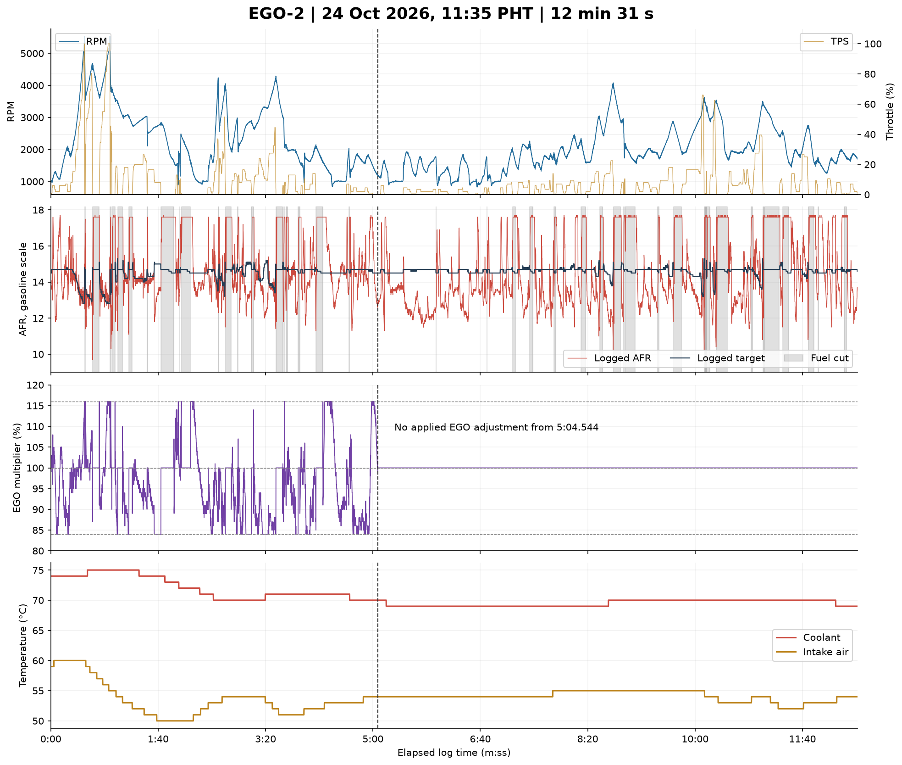
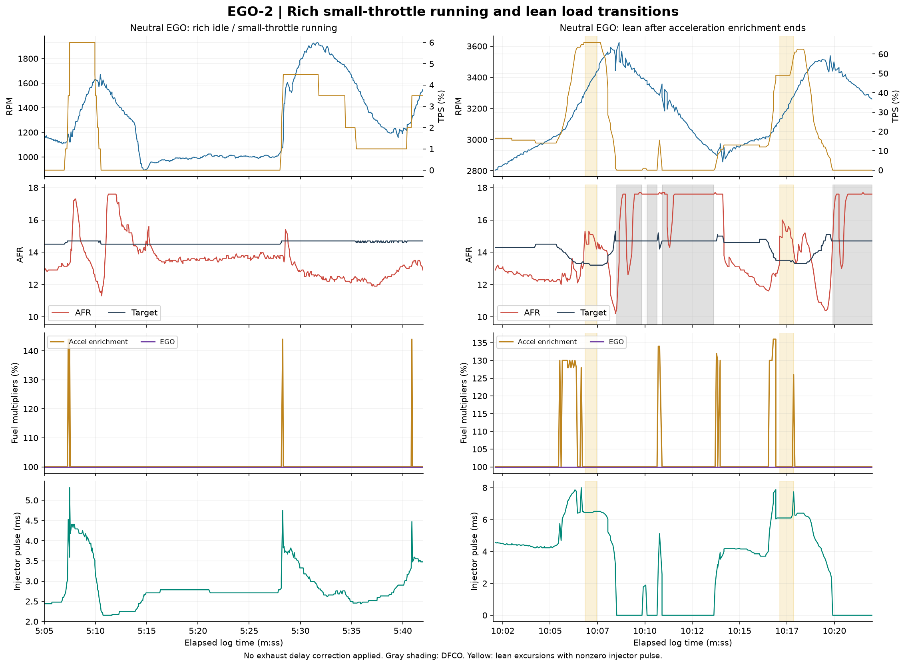

# EGO-2 analysis — 24 October 2026

**Main finding: with EGO adjustment removed, settled idle and small-throttle operation are rich relative to their logged targets, while higher-load throttle transitions still go lean. The error changes with operating condition; a blanket fuel adjustment or EGO PID change would not address both.**

Source: `DataLogs/EGO-2.msl`, capture approximately **11:35:34–11:48:05 PHT**, Speeduino 2025.01.6. Analyzed **11,263 records over 751.092 seconds**. The owner answered yes when asked about a correction/settings change near 5:04 and agreement between the AEM gauge and TunerStudio. This is reported agreement, not an independent voltage or calibration inspection.

No tune, ECU setting, dashboard, or project configuration was changed during this analysis. Other newly supplied logs, including the NON-EGO and gear-pull files, were not analyzed here.

## Data quality and operating coverage

| Item | EGO-2 |
|---|---|
| Records / channels | 11,263 / 78; every data row has the expected field count |
| Timing | Nondecreasing; 1,643 duplicate timestamps retained; largest interval 0.201 s |
| Initial clock reset | None found; no initial data record removed |
| RPM / throttle | 825–5,534 RPM / 0–100% TPS |
| MAP / barometer | 14–91 kPa / fixed 93 kPa barometric reading |
| AFR / target | 9.7–17.7 / 12.8–15.3 |
| Coolant / intake air | 69–75°C / 50–60°C |
| Warm-up, air, barometric, battery correction channels | All remain at 100% |
| Battery voltage | 13.1–13.4 V |
| Maximum injector duty | 40.4% |
| Sync-loss counter / status | Constant 41 / constant 2 |
| ECU Error # / Error ID | Both zero throughout |
| Fuel cut | 148.14 s; every DFCO record has PW = 0 and TPS = 0 |

This MSL is a text export. Unlike the original EGO-1 binary, it does not provide per-record checksums for independent verification. Validation here covers numeric parsing, complete rows, missing values, timing, and channel consistency. The units row is excluded from numeric analysis.

## Two distinct correction phases

| Phase | Interval | Logged EGO behavior |
|---|---|---|
| Varying correction | Start to approximately 5:04.544 | Gego varies between 84% and 116% |
| Neutral correction | 5:04.544 to 12:31.092 | Gego remains exactly 100%; no EGO fuel adjustment is applied |

The transition is determined by record order: two records share timestamp 304.544 s, with Gego 99% followed by 100%. The latter begins the persistent neutral phase. The final 7 min 26.5 s must not be pooled with the first phase when evaluating feedback performance. A 100% multiplier indicates no applied adjustment; the log does not contain a dedicated configuration-change record identifying the setting changed.

During the varying phase, the controller spends **31.55 s at 84%** and **11.36 s at 116%**. These are substantial periods at the observed correction limits.

## 1. Base fueling reads rich at idle and small throttle

The most representative idle subset requires TPS exactly zero, RPM 900–1,100, and the settled filter described below. With neutral EGO, it provides **22.74 seconds**:

| Channel | Result |
|---|---|
| RPM | Time-weighted mean 1,000; observed range 962–1,061 |
| Measured AFR | Mean **13.56**, median 13.5, range 13.2–14.0 |
| Logged AFR target | **14.5** throughout this subset |
| EGO multiplier | 100% |
| Idle command | Median 63%; range 59–65% |

This is repeatable idle near the RPM target with a richer mixture than commanded. It is not evidence that the engine must run at 14.5 to idle well; the immediate finding is a mismatch between the measured mixture and the tune's requested mixture. Decide the intended idle target before calibrating to it.

The broader neutral-EGO settled-idle subset contains 25.21 s and averages 13.54 AFR against an average target of 14.50. The varying-EGO settled-idle subset is smaller (15.67 s), averages 14.12 against 14.5, and has a median EGO multiplier of 91%. Its distribution is consistent with feedback subtracting fuel, but these subsets are not matched before/after trials at identical conditions.

For neutral-EGO settled operation above idle, **34.08 seconds** average **12.91 AFR against a 14.60 target**. Examples using broad RPM/TPS bands:

| Selected operating band | Retained time | Mean measured AFR | Mean target |
|---|---:|---:|---:|
| 1,000–1,499 RPM; >1–5% TPS | 6.41 s | 12.69 | 14.70 |
| 1,500–1,999 RPM; >1–5% TPS | 10.12 s | 12.61 | 14.70 |
| 1,500–1,999 RPM; >5–10% TPS | 4.34 s | 13.02 | 14.70 |
| 2,000–2,499 RPM; >5–10% TPS | 2.87 s | 13.05 | 14.81 |
| 2,500–2,999 RPM; >10–20% TPS | 7.86 s | 13.15 | 14.30 |

These are diagnostic bands, not exact VE-table cells or percentage-change instructions. They identify where repeated steady measurements are useful. The fuel-load channel follows TPS, so table work belongs in RPM × TPS coordinates.

## 2. Lean load transitions persist with neutral EGO

The following examples occur after EGO becomes neutral, with nonzero injector pulse width, no DFCO, and no Hard Launch flag:

| Elapsed time | RPM / TPS / MAP | Measured AFR | Target | Duration of selected excursion |
|---|---|---|---|---|
| 10:06.84–10:07.38 | 3,307–3,413 / 66% / 91 kPa | 14.5–15.3 | 13.2–13.3 | 0.61 s |
| 10:17.11–10:17.78 | 3,131–3,272 / 49–55% / 89–90 kPa | 14.8–16.0 | 13.4–13.5 | 0.74 s |
| 10:56.32–10:57.58 | 2,227–2,476 / 27.5% / approximately 88 kPa | 15.5–16.4 | 14.3–14.5 | 1.33 s |
| 11:40.48–11:41.76 | 2,088–2,310 / 25–26.5% / 87–89 kPa | 15.5–16.6 | 14.4–14.5 | 1.33 s |

At **10:06.38**, enrichment is 128%, AFR is 12.8 and pulse width is 7.781 ms. At **10:06.78**, enrichment is back to 100%, pulse width is 6.514 ms, and AFR is 13.3. At **10:07.04**, AFR reaches 15.3 against 13.3 while pulse width is 6.449 ms and TPS remains 66%.

The second event has a similar sequence: enrichment adds fuel during opening, then AFR rises after the enrichment multiplier returns to 100%. This is consistent with an enrichment handoff/duration issue and/or insufficient base fuel in the newly entered load region. It does not prove duration alone is responsible: RPM/load continue to change, and the exhaust measurement is delayed.

The longer lean intervals at approximately 2,200–2,500 RPM and 25–28% TPS also make that higher-load region worth checking with controlled holds. A fixed TPS during acceleration is not a fully steady engine condition. Do not infer the exact VE correction from these transient AFR/target ratios.

**Because these excursions remain without EGO adjustment, EGO PID behavior alone cannot explain them.** Accurate wideband scaling, combustion quality, and fuel delivery still matter, but the diagnosis should now separate rich small-throttle base fueling from the leaner load-transition response.

## 3. Brief Hard Launch activity complicates high-RPM AFR

The log's Hard Launch channel activates on three records:

| Elapsed time | RPM | TPS | AFR / target |
|---|---:|---:|---|
| 0:30.933 | 5,245 | 91.5% | 13.3 / 12.8 |
| 0:31.134 | 5,319 | 97.5% | 12.9 / 12.8 |
| 0:54.804 | 5,292 | 100% | 13.1 / 12.8 |

The status is active for about **0.197 s total** at the sampling resolution. Shortly after those flags, AFR reads 15.0 at 0:31.273 and 15.3–15.4 near 0:54.865–0:55.005. Treat these high-RPM lean indications separately from the later clean transition examples. Cut/interrupted combustion can leave excess oxygen in the exhaust; injector pulse width being nonzero does not rule out an ignition cut.

The matching local controller definition identifies Hard Launch as `launchHard` (`projectCfg/mainController.ini`, output channel bit at offset 32, bit 0). Its help text describes launch hard limiting as fuel and/or ignition cutting. This establishes the meaning of the logged status, not direct measurement of individual spark or injector events.

The tune saved later has launch enabled, Arduino input 18, LOW polarity, and soft/hard values 5,400/5,500 RPM. Do not assume these were the exact settings during the log or identify an ECU connector pin from that Arduino number. Check whether launch activity was intended and verify the configured input/switch state before interpreting further pulls near this RPM. The ordinary Hard Limiter channel remains zero.

High TPS (≥80%) totals only **5.93 seconds**, all before the neutral-EGO phase. Mean AFR is 13.31 against mean target 12.83, and median EGO is 113% (+13% fuel). This does not validate the uncorrected full-load map. There is no ≥80% TPS coverage with neutral EGO.

## 4. Idle recovery looks less severe, but this is not a controlled improvement test

| Observation | EGO-1 | EGO-2 |
|---|---:|---:|
| Minimum logged RPM | 679 | 825 |
| Closed-throttle time below 850 RPM | 27.0 s | 0.20 s |
| Maximum logged idle command | 100% | 87% |
| New sync-loss increments within capture | 0 | 0 |

EGO-2 contains much less retained settled idle and more higher-RPM operation. Coolant is warmer (69–75°C versus 66–70°C), intake air is generally hotter, the idle AFR target is 14.5 rather than the earlier 14.3, and barometric readings differ (93 versus 98 kPa). These are not otherwise identical tests, so the reduced RPM dips cannot be assigned to one change.

A low-RPM recovery event still occurs near **6:36.97**, with RPM 825, TPS 1%, AFR 15.0–15.4 and idle command 56%. Later the same episode reaches 16.5 AFR as RPM begins to recover. Small-TPS idle eligibility remains worth checking; an overall “Idle Control = 1” channel does not prove that closed-loop action is engaged at every moment.

Sync-loss count stays at **41**, so no new count is added during EGO-2. That starting value is higher than EGO-1's six. The intervening recordings, engine starts, and ECU state are not established by these two files; the higher starting count must not be described as 35 losses occurring inside EGO-2.

## 5. The observed lean ceiling remains

The AFR channel repeatedly reads 17.6, occasionally 17.7. Time at ≥17.6 totals approximately **173.84 s**, of which **125.79 s** is DFCO and **48.06 s** occurs while fuel is commanded. Fuel-cut and recovery readings should not drive VE increases.

The changed maximum (17.7 versus 17.6) does not resolve the apparent plateau. Reported gauge agreement supports using the normal-range measurements provisionally, but raw analog voltage and AEM status are absent. Agreement at idle does not establish upper-range accuracy. The [AEM 30-0300 manufacturer instructions](https://documents.aemelectronics.com/techlibrary_30-0300_x-series_wideband_uego_afr_sensor_gauge.pdf) define its analog transfer function and signal-ground requirements; compare the gauge and ECU specifically when the logged channel is at its ceiling if that can be observed without another loaded pull.

## Interpretation and next work

1. **Check the brief launch activation first before further high-RPM tests.** Establish whether the switch/input behavior is intended. Do not change its polarity or limit values based only on this capture.
2. **Compare the supplied NON-EGO logs against these rich RPM/TPS bands.** If the richer small-throttle readings repeat under stable, comparable conditions, prepare local base-fuel revisions rather than a blanket reduction across the map. Settle the intended idle AFR target before changing idle fuel.
3. **Evaluate load-region base fueling separately from enrichment handoff.** The lean transitions persist with neutral EGO, so changing feedback gains alone is insufficient. The [Speeduino acceleration guide](https://wiki.speeduino.com/en/configuration/Acceleration_Wizard) distinguishes enrichment amount from duration; this log narrows that investigation but does not identify a numerical correction yet.
4. **Retest with matching ECU tune snapshots and consistent conditions.** Verify actual ignition timing and fuel delivery before additional loaded calibration. No calibrated fuel-pressure installation, knock measurement, or timing-light result is established here.

Avoid more full-load pulls until the clean lean-transition events and unintended cut behavior, if any, are resolved. No ignition advance or exact fuel-table change is justified by this report alone.

## Saved tune and analysis method

`CurrentTune.msq` was saved at **12:11:52 PHT**, around 24 minutes after EGO-2 ended and after several other log files were recorded. Its PID configuration cannot override the observed neutral multiplier during the latter part of EGO-2. Its acceleration time is now 50 ms, compared with 200 ms in the earlier saved context; there is no evidence tying the time of that edit to this particular recording. Do not attribute the logged lean events to the later 50 ms setting without a matching tune snapshot.

All statistics are time-weighted: each sample is held to the next timestamp, duplicate timestamps have zero duration, and the final sample has zero duration. The original row order is retained. Settled selection requires the preceding two seconds to have |TPS rate| ≤5%/s, |RPM rate| ≤200 RPM/s, acceleration enrichment 100%, and DFCO off; the first two seconds following the neutral-EGO transition are additionally excluded. Broad idle selection adds TPS ≤1% and RPM 700–1,300. Centered idle adds TPS exactly zero and RPM 900–1,100 instead. These are analytical filters, not ECU settings.

AFR-to-target comparisons are at logged timestamps with no exhaust-delay correction. Band statistics aggregate observations and are not exact fuel-table cell values. No oil/fuel pressure conclusion is drawn from the channels bearing those names because their physical installation/calibration has not been verified.

Reproducible outputs: `metrics.json`, `validation.json`, `EGO-2-analysis.csv`, `high-load-excursions.csv`, `neutral-EGO-steady-bands.csv`, `later-saved-tune-context.json`, and PNG/SVG versions of the figures. Source-file hashes are recorded in `metrics.json`. Script: `Diagnostics/analyze_ego2.py`.
