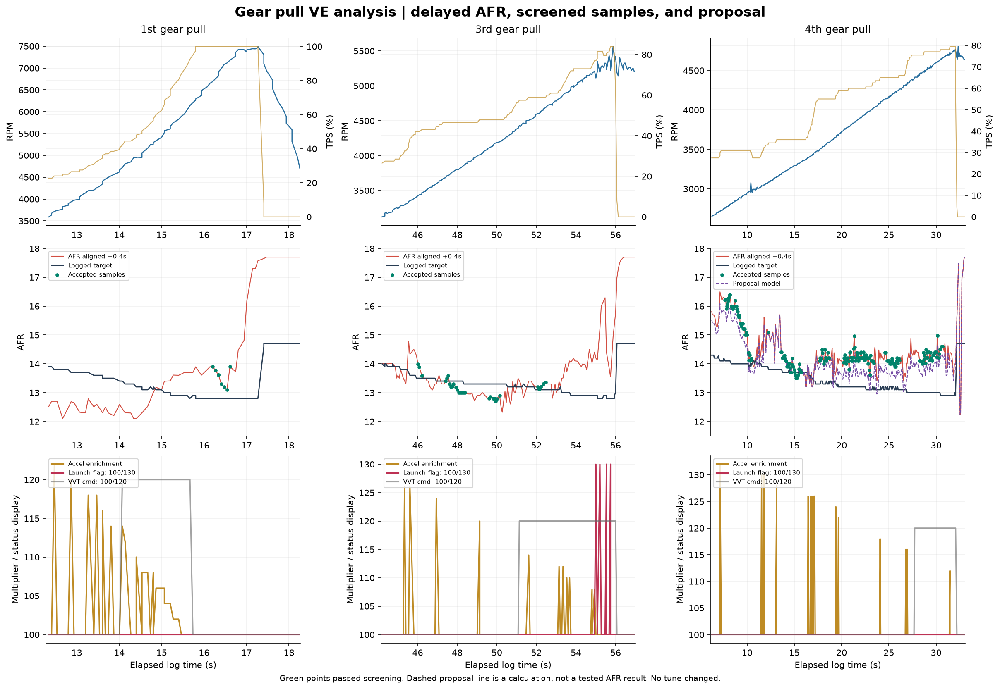

# VE analysis and proposed changes — gear-pull logs

24 October 2026. **The 4th-gear pull provides the strongest sustained-load evidence and supports local fuel additions. The 1st-gear high-RPM evidence is too brief and delay-sensitive for a committed edit, and launch activity contaminates the upper part of the 3rd-gear pull.**

This is a custom offline analysis, not an execution of MegaLogViewer's proprietary VE Analyze engine. The output is a review-only seven-cell proposal. **No ECU write or change to `CurrentTune.msq` was made.** Earlier idle/cruise proposals are not included in this proposal.

## Inputs and validation

Both first-gear files were inspected because the project contains a general `1st gear` recording and a separate `1st gear pull` recording.

| File | Capture start, PHT | Analyzed duration | Records | RPM maximum | Maximum TPS | Screened loaded time |
|---|---|---:|---:|---:|---:|---:|
| 1st gear.msl | 12:09:11 | 79.064 s | 1,188 | 3,395 | 56.5% | 0 s |
| 1st gear pull.msl | 12:10:36 | 19.275 s | 291 | 7,494 | 100% | 0.540 s |
| 3rd gear pull.msl | 12:07:03 | 58.340 s | 875 | 5,564 | 84% | 2.445 s |
| 4th gear pull.msl | 12:08:17 | 38.999 s | 586 | 4,803 | 79.5% | 13.665 s |

Each file begins with a prior logging-clock snapshot followed by a reset to 0.001 s; the first record in each file was excluded. Every remaining row has the expected field count, numeric data contain no missing values, and timestamps are nondecreasing. Duplicate timestamps were retained. The text exports do not provide per-record binary checksums.

All four captures have **Gego = 100% throughout**. Sync-loss count stays at **49**, with sync status 2, and the normal Hard Limiter channel remains zero. The saved VE table was written at **12:11:52 PHT**, after these recordings. Every retained log record's VE is within **1.1 absolute VE points** of bilinear interpolation of that saved table. This supports using it as the proposal baseline, allowing for integer interpolation/rounding; it does not independently prove every fuel-system or configuration parameter was unchanged.

Coolant coverage is only 66–68°C and intake air 41–46°C across these files. Warm-up and air correction channels are neutral. The estimates apply to these recorded conditions; neither normal operating temperature accuracy nor temperature compensation is validated.

## Proposed first-stage cell changes

All seven edits are additions. They intentionally implement less than the full calculated AFR error and preserve the existing adjacent-TPS ordering rather than adding unsupported neighboring edits.

| RPM node | TPS node | Saved VE | Proposed VE | Change | Evidence / limitation |
|---:|---:|---:|---:|---:|---|
| 2,500 | 30% | 55 | **57** | +3.64% | Lower interpolation boundary of the lean approximately 2,700–3,000 RPM segment; limited direct node coverage |
| 3,000 | 30% | 55 | **57** | +3.64% | Same segment; stronger interpolation support than the 2,500 node |
| 3,500 | 60% | 67 | **69** | +2.99% | Sustained approximately 55–60% TPS segment; limited to avoid a new reversal against the next TPS node |
| 4,000 | 60% | 68 | **71** | +4.41% | Sustained lean segment near 60–66% TPS |
| 4,000 | 70% | 70 | **72** | +2.86% | Adjacent support; limited to the unchanged 80% node's value |
| 4,500 | 70% | 71 | **74** | +4.23% | Sustained lean segment near 70–79.5% TPS |
| 4,500 | 80% | 73 | **75** | +2.74% | Upper throttle boundary of that segment; limited to the unchanged 90% node's value |

**All other 249 VE cells remain unchanged in the proposal.** AFR targets, ignition timing, enrichment, launch settings, load axes, MAP multiplication, required fuel, and injector settings remain unchanged.

The strongest evidence is from one 4th-gear pull, not repeated identical trials or confirmation of these exact regions in all gears. These are conservative first-stage candidates for controlled validation, not a finished full-load calibration or a declaration that further pulls are safe.

## 4th gear: consistent lean bias in several sustained-load segments

The screened values below use nominal 0.4-second AFR alignment. Calculated full correction is the local measured-AFR/target ratio minus one; it is not the proposed change to every bounding cell.

| Observed RPM / TPS interval | Usable time | Measured AFR | Logged target | Calculated full local correction |
|---|---:|---:|---:|---:|
| 2,500–2,999 / >30–40% | 2.732 s | 15.60 | 14.02 | +11.2% |
| 3,000–3,499 / >30–40% | 2.331 s | 13.99 | 13.71 | +2.0% |
| 3,500–3,999 / >50–60% | 3.399 s | 14.24 | 13.24 | +7.5% |
| 3,500–3,999 / >60–70% | 0.537 s | 14.07 | 13.10 | +7.4% |
| 4,000–4,499 / >60–70% | 1.930 s | 14.10 | 13.15 | +7.2% |
| 4,000–4,499 / >70–80% | 0.608 s | 14.14 | 13.00 | +8.7% |
| 4,500–4,999 / >70–80% | 1.928 s | 14.40 | 12.98 | +10.9% |

Most upper-load segment means vary by approximately 0.2–1.7 percentage points when assumed delay is changed over 0–0.6 s. The lower 2,500–2,999 RPM segment varies by about 2.9 points and has lower confidence in the exact correction magnitude, although the direction remains toward additional fuel.

The 4th-gear pull does not reach wide-open throttle: maximum TPS is 79.5%. Its MAP reaches 92 kPa, indicating high manifold pressure relative to the logged 93 kPa barometer, but the data do not justify automatically copying additions into 90–100% TPS cells.

## 3rd gear: protect the already-close regions and exclude launch activity

Clean retained data at approximately 3,500–4,000 RPM / 40–50% TPS average **13.19 AFR against 13.39 target**, and at 4,000–4,500 RPM / 40–50% TPS average **12.81 against 13.30**. These regions are already close or richer than target. Their coverage is short, so no reductions are proposed, and the 40–50% nodes are not increased.

The proposal was replayed through the interpolated table along the retained 3rd-gear sample path. It makes no modeled change to the accepted regional means shown in the CSV, rather than applying the 4th-gear additions across every throttle row. Some unscreened transition samples can still receive a small interpolated effect; unchanged means in the selected data are not proof that all 3rd-gear behavior is unaffected.

Hard Launch activates at approximately:

| Elapsed time | RPM | TPS |
|---|---:|---:|
| 55.007 s | 5,113 | 77% |
| 55.208 s | 5,195 | 81.5% |
| 55.540 s | 5,309 | 79.5% |
| 55.744 s | 5,330 | 84% |

These events and the guarded surrounding samples are excluded from fuel fitting. The upper part of this pull reaches AFR 16.3, but an AFR indication around an ignition/fuel cut cannot be assumed to mean the base VE table needs that entire increase. Verify whether launch activation is intended and establish the input/switch behavior before using another high-RPM pull for calibration. No launch setting is altered by this proposal.

## 1st gear: investigate high-RPM mixture, hold the cells for now

The general `1st gear.msl` file has only rapid throttle/load changes at low RPM and no qualifying loaded segment. It does not support a VE change under this analysis.

The separate `1st gear pull.msl` reaches **7,494 RPM at 100% TPS**. After enrichment and VVT-command transitions, throttle movement, MAP changes, and lift-off guards are excluded, only **0.54 s** remains:

| Observed RPM / TPS | Usable time | Aligned AFR / target | Calculated local correction | Delay sensitivity |
|---|---:|---:|---:|---:|
| 6,500–6,999 / >90–100% | 0.27 s | 13.64 / 12.80 | +6.6% | 3.3 percentage points |
| 7,000–7,499 / >90–100% | 0.27 s | 13.52 / 12.80 | +5.6% | 4.8 percentage points |

This points toward further investigation of mixture at high RPM, but the retained segments are too short, fast, and sensitive to exhaust delay for a committed table edit. VVT command also changes from active to inactive earlier in the pull; a stable command is not proof of actual cam position or that mechanical response has settled. **No 6,000–9,000 RPM or 90–100% TPS changes are proposed.**

## Predicted effect of the seven changes

The following is a calculation on the original log, assuming proportional fuel delivery and unchanged airflow. It is not a measured result:

| 4th-gear observed region | Measured mean AFR | Modeled AFR with proposal | Logged target |
|---|---:|---:|---:|
| 2,500–2,999 / >30–40% TPS | 15.60 | **15.16** | 14.02 |
| 3,500–3,999 / >50–60% TPS | 14.24 | **13.80** | 13.24 |
| 4,000–4,499 / >60–70% TPS | 14.10 | **13.66** | 13.15 |
| 4,500–4,999 / >70–80% TPS | 14.40 | **14.03** | 12.98 |

**The proposal does not fully resolve the lean error in this model.** The actual interpolated fuel addition is often smaller than the percentage at an individual changed node because untouched nodes share the interpolation. A controlled validation should confirm that added fuel produces the expected mixture response before expanding the changes. Do not interpret these partial additions as permission for sustained full-load operation or another sweep to 7,500 RPM. Ignition timing, knock behavior, actual fuel pressure, and injector characterization are not verified by this analysis.

## How the estimates were produced

The table uses RPM × TPS; MAP is still a fuel multiplier with the saved Fixed option. The fuel table is interpolated between neighboring nodes, so regional corrections must be considered together rather than pasted into independent cells. [Speeduino VE-table documentation](https://wiki.speeduino.com/en/configuration/VE_table)

Nominal fuel estimate: **local VE correction factor = AFR at time t + 0.4 s / logged AFR target at time t**, with Gego neutral. Delay sensitivity is evaluated at 0, 0.2, 0.4, and 0.6 s. These delays are assumptions, not a measured transport-delay curve. Duplicate timestamps retain original order and zero duration; their last reading is used only when interpolating delayed AFR.

Pull filtering deliberately permits rising RPM. Over an approximate *t − 0.5 s* through *t + 0.6 s* window, it requires acceleration enrichment and total fuel correction to remain 100%, no fuel cut/normal limiter, positive pulse width, TPS span ≤5 percentage points, MAP span ≤3 kPa, constant VVT command, and sync status 2. Hard Launch is guarded over approximately *t − 1.0 s* through *t + 0.6 s*. Samples also require TPS ≥30%, MAP ≥80 kPa, and nominal aligned AFR between 9.0 and 17.4. Windows end at the first sample at or after the future boundary, so their exact width depends on sampling. These are custom screening criteria, not official VE Analyze defaults.

These accepted pull samples are **not steady-state dyno measurements**. Airflow, fuel film, cam response, and temperature may still change while RPM rises. The lower-throttle startup, gear-change, and tip-in spikes were not used to inflate VE. The sensor's recurring upper AFR plateau is excluded, and no physical pressure conclusion is drawn from unverified fuel/oil pressure channels.

For proposal replay: **modeled AFR = delayed measured AFR / (proposed interpolated VE / saved interpolated VE)**. This accounts for all four contributing nodes rather than applying a node's percentage directly to the whole sample. It assumes a correct signal transfer function and proportional fuel response; it does not establish real-world safety or validate the proposal.

Files: `proposed-cell-changes.csv`, `proposed-VE-table-review-only.csv` (all 256 proposed values, TPS rows ascending), `regional-results-and-proposal-replay.csv`, `node-support.csv`, four per-log analysis CSVs, `validation-and-method.json`, and PNG/SVG charts. Interpolation-weighted seconds in node support are fractional contributions, not time spent exactly on a node. Source hashes and excluded initial records are recorded in the JSON. Reproduce with `Diagnostics/analyze_gear_pull_ve.py`.
