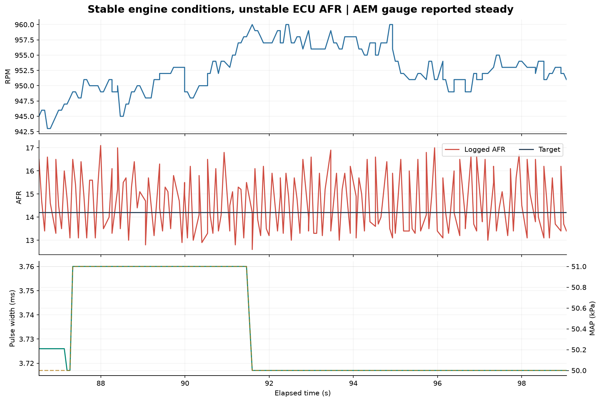

# NON-EGO VE analysis — 24 October 2026, 22:47 PHT

**Analysis completed. No VE changes are recommended from this run because the ECU AFR channel disagrees with the reported steady AEM gauge.** Regional mathematical estimates were calculated and saved for diagnosis, with every result marked **DO NOT APPLY**.

This is a custom offline VE analysis, not an execution of MegaLogViewer's proprietary VE Analyze algorithm. The source tune, ECU settings, and datalog were not modified.

## Data and tune checks

| Check | Result |
|---|---|
| Source | `DataLogs/NON-EGO.msl` |
| Capture | Approximately 22:47:34–22:53:34 PHT |
| Data | 5,394 records; 76 logged fields; 359.764 seconds |
| EGO correction | Gego 100% throughout; saved algorithm No correction |
| Tune compatibility | Every record within 1.1 absolute VE points of the saved table's bilinear interpolation |
| Saved tune analyzed | 23:00:28 PHT; after the capture |
| Physically settled data | 77.158 seconds under the stated filters |
| Both physical and AFR stability screens | 0 seconds |
| Owner's observation | AEM gauge steady; TunerStudio fluctuated |
| Released VE changes | **None** |

The units row was skipped, all data rows have the expected width, and there are no missing numeric values. One initial timestamp moves backward by 0.001 s; it was clamped to the previous timestamp for analytical timing, with original times preserved in the export. No large initial stale-time record was removed. Duplicate timestamps have zero duration. The largest interval is 0.343 s. Text MSL exports do not provide per-record checksums.

RPM spans 467–6,275, TPS 0–100%, MAP 13–90 kPa, AFR 10.4–17.6, coolant 69–74°C, intake air 60–63°C, and battery voltage 12.2–13.4 V. Sync-loss count stays at ten with status two. Hard Launch and Hard Limiter remain zero. These facts do not establish knock-free timing or correct physical pressure measurements.

The live tune file was saved again externally during the analysis. The comparison was refreshed against the 23:00:28 version, and its exact VE table, axes, selected context, and hash are preserved in the JSON. The datalog did not change. The current table has changed substantially from the earlier daytime analyses. The saved settings still use TPS load with Fixed MAP multiplication, required fuel 9.1 ms, injector opening time 0.9 ms, and AFR multiplication/incorporation disabled. Earlier proposals must not be applied automatically to this different baseline.

## Why the AFR channel cannot presently support a VE revision

The discrepancy persists while commanded fuel and engine conditions barely change. A representative section at **86.53–99.07 seconds** has approximately:

| Channel | Observed range |
|---|---|
| RPM | 943–960 |
| TPS | 0% |
| MAP | 50–51 kPa |
| Logged VE | 62, constant |
| Injector pulse width | 3.717–3.760 ms |
| Logged AFR | **12.6–17.1** |
| AFR target | 14.2 |

Across the entire capture, **1,390 successive comparisons show an AFR jump greater than 2.0 units over a 20–150 ms logged interval**. This count excludes duplicate-time intervals and is not a count of distinct physical faults.

Given the owner's steady-gauge observation, investigate the AEM analog-output/return path, ECU input/reference, and signal processing before using this channel for fuel changes. The log cannot identify which component is responsible. A steady gauge display is not an electrical measurement of the analog output; display averaging and update behavior may differ from the logged channel. Actual voltage comparison is the next discriminator, rather than assuming either a failed ECU or real rapid mixture swings.

## Regional calculations — diagnostic only

The arithmetic was completed using nominal 0.4-second AFR alignment. The figures below must not be converted into table edits:

| Observed band | Physically settled time | Mean aligned AFR / target | Nominal mathematical change | Status |
|---|---:|---:|---:|---|
| 500–999 RPM, TPS 0% | 70.10 s | 14.88 / 14.20 | +4.79% | Hold |
| 1,000–1,499 RPM, TPS 0% | 3.73 s | 13.86 / 14.20 | −2.41% | Hold |
| 1,000–1,499 RPM, >1–5% TPS | 2.73 s | 14.14 / 14.60 | −3.15% | Hold |

The lower-RPM idle samples have a median 2.6-second AFR span of approximately four units. A single average conceals that variation. No repeatable cruise or loaded region qualifies for a change under this screen.

The custom AFR-stability screen requires the AFR span in the same analysis window to be no more than one unit. That threshold is an analyst-selected screening criterion, not a manufacturer limit or a proof of sensor failure. **The reason to withhold the changes is the unexplained channel disagreement and large fluctuations, not the threshold alone.**

## Calibration evidence narrows the next checks

Unlike the earlier daytime file, the current `std_ms2geno2.log` now records a full calibration export at **21:44** with custom-linear points **0.5 V = 8.5 AFR** and **4.5 V = 18.0 AFR**. These match the AEM 30-0300 analog relationship. This confirms what the local calibration record says was sent; it is not a live ECU lookup-table readback or proof of the analog voltage reaching the correct input.

AEM specifies white as analog positive and brown as analog negative; with a nondifferential ECU input, its instructions call for the brown return to shared signal ground. Its relationship is AFR = 2.375 × volts + 7.3125. [AEM manufacturer instructions, analog-output section](https://documents.aemelectronics.com/techlibrary_30-0300_x-series_wideband_uego_afr_sensor_gauge.pdf)

Recommended diagnostic sequence, without changing the VE table:

1. Verify actual white/brown signal routing and connections against the installed ECU's schematic, especially the analog return. The ECU's exact connector pinout has not been verified here; do not identify a pin by guesswork or wire color alone.
2. With suitable safe probing, compare voltage across white-to-brown at the AEM output with O2-input-to-signal-ground at the ECU during the same steady idle. Avoid shorting adjacent live pins, and keep clear of ignition wiring, hot exhaust, belts, and fans. A meter can establish averages/offsets but may miss fast fluctuations; an oscilloscope or suitable logger is better for the fast component.
3. If the AEM analog voltage is steady but the ECU-end measurement moves, investigate the cable/return/connection path. If ECU input voltage is steady while reported AFR moves, investigate the ECU analog reference/input, firmware configuration, or telemetry/calibration path. If the AEM analog output itself moves despite a steady display, inspect output/reference behavior before blaming the ECU.
4. Saved `ADCFILTER_O2` is 128. Its value alone does not identify the cause; no filter change was made. Avoid treating extra smoothing as proof that the signal path is correct.
5. Once gauge, output voltage, and ECU readings agree at stable conditions, record a new short neutral-EGO idle/light-load log with the matching ECU tune snapshot, then repeat the VE analysis.

## Other recorded concern

At **343.496 seconds**, RPM reaches **467** with TPS zero, idle command 100%, MAP 71 kPa, and pulse width 4.919 ms. This is a real logged low-RPM event requiring idle-recovery investigation. The unreliable AFR channel cannot establish whether it was caused by richness, leanness, misfire, accessory load, or another condition. Closed-throttle time below 850 RPM totals approximately 14.07 seconds. Do not use the AFR at that event as a VE correction factor.

## Method and outputs

The physical-settling screen uses approximately *t − 2 s* through *t + 0.6 s*, requiring TPS span ≤0.5 percentage point, MAP span ≤3 kPa, RPM span ≤150, constant logged VE and VVT command, neutral total correction/enrichment, no cuts, positive injector pulse width, and sync status two. Near-closed overrun above 1,300 RPM is excluded. Nominal arithmetic uses AFR at *t + 0.4 s* divided by target at *t*; delays 0, 0.2, 0.4, and 0.6 s are also retained. These are analytical assumptions, not measured exhaust delays or ECU settings.

The mechanical filter permits 77.158 seconds, but all candidate regions are withheld based on signal quality and the owner's observation. No proposed replacement table or edited `.msq` is generated.

Outputs: `NON-EGO-screened.csv`, `quarantined-regional-calculations.csv`, `validation-and-method.json`, and PNG/SVG plots. The JSON records source hashes, timestamp repair, saved context, and disposition. Reproduction script: `Diagnostics/analyze_latest_non_ego.py`.
