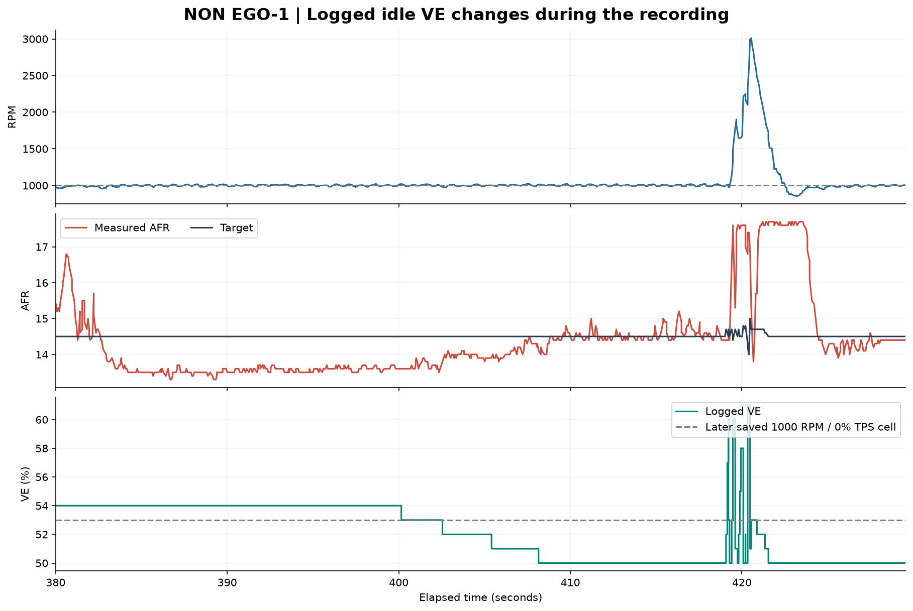
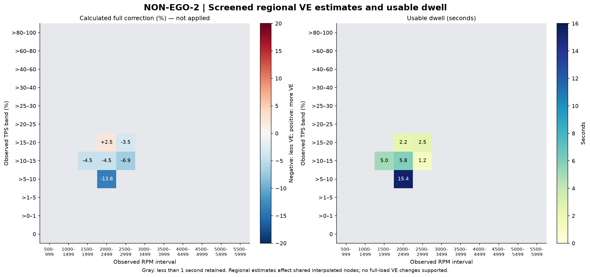

# Offline VE analysis: NON EGO-1 and NON-EGO-2

Analyzed 24 October 2026. **The clearest supported areas are idle and 2,000–2,500 RPM at >5–10% TPS. The logs do not support a blanket trim across 10–20% TPS and 2,000–5,000 RPM, or a complete replacement VE map.**

No ECU setting, tune, dashboard, or project configuration was modified. The numerical results below are proposed local estimates for review, not applied calibration changes or an export from MegaLogViewer's proprietary VE Analyze algorithm.

## What was analyzed

| Run | Capture start (PHT) | Duration | Analyzed records | EGO multiplier | Sync-loss count |
|---|---|---:|---:|---|---|
| NON EGO-1 | 11:48:14 | 7 min 09.5 s | 6,441 | 100% throughout | Constant 41 |
| NON-EGO-2 | 11:57:37 | 9 min 20.4 s | 8,406 | 100% throughout | Constant 49 |

The first file contains one initial record at 751.154 seconds, followed by its logging-clock reset to 0.001 seconds. That stale-clock record was excluded; no such removal was needed for the second run. Units rows were skipped, every remaining row had the expected 76 fields, numeric fields contain no missing values, and remaining timestamps are nondecreasing. Duplicate timestamps were retained with zero duration. These text MSL exports do not offer per-record checksums for independent verification.

Only **50.66 seconds from NON EGO-1** and **32.56 seconds from NON-EGO-2** pass the conservative VE screening. Most of the total 16½ minutes consists of changing operating conditions, cuts/recovery, changing VE, or insufficient settling. Lack of retained data is not evidence that an unmeasured map area is correct.

The owner reported trimming the 10–20% TPS area between approximately 2,000 and 5,000 RPM. Accordingly, the first run is not pooled with the second as if the fuel table were fixed.

## Tune compatibility and interpolation matter

The current saved tune is timestamped **12:11:52 PHT**, after both runs. It uses TPS fuel load, a 16 × 16 VE table, required fuel 9.1 ms, injector opening time 0.9 ms, MAP multiplication set to Fixed, and both AFR multiplication/incorporation options set to No. These are saved settings, not independent proof of every setting used during the recordings.

The logged FuelLoad channel matches TPS in both files. Comparing logged VE against bilinear interpolation of the saved table gives:

- **NON-EGO-2: every analyzed record is within 1.1 VE points of the saved-table interpolation.** This is compatible with ECU integer interpolation/rounding and makes this run the best available reference for the current table. It does not prove required fuel, dead time, fuel pressure, or every other setting was identical.
- **NON EGO-1: approximately 64% of records meet that tolerance.** Larger differences occur in the trimmed region and later at idle. The first run contains multiple table states and must be evaluated using its logged VE, not overwritten with values from the later tune.

The tolerance is 1.1 absolute VE percentage points, not 1.1% relative error.

The primary coordinates are RPM × TPS, but **MAP still multiplies the fuel calculation** with the Fixed option. That is why the screening also requires steady MAP. Changing this option would require retuning and is outside this analysis. With AFR incorporation disabled and EGO neutral, changing the AFR target alone would not make the engine deliver the requested mixture. [Speeduino VE-table documentation](https://wiki.speeduino.com/en/configuration/VE_table)

## 1. Idle: the first run contains a useful live trim experiment

Near the end of NON EGO-1, TPS remains zero, RPM stays close to 1,000, and MAP stays approximately 38–39 kPa while logged VE changes **54 → 53 → 52 → 51 → 50**. The following statistics retain settled samples at 950–1,050 RPM, 0% TPS, 37–40 kPa, and a constant logged VE throughout the analysis window:

| Logged VE | Retained time | Delay-aligned mean AFR | Target AFR | Calculated effective VE to match target |
|---:|---:|---:|---:|---:|
| 54 | 31.66 s | 13.65 | 14.50 | 50.82 |
| 52 | 0.33 s | 13.88 | 14.50 | 49.77 |
| 51 | 0.13 s | 14.30 | 14.50 | 50.30 |
| 50 | 12.54 s | **14.48** | **14.50** | **49.91** |

The intermediate steps are too short to tune from independently. The longer VE 54 and VE 50 plateaus are the useful evidence. Around 6:50–6:58, VE 50 gives approximately 14.4–14.8 AFR while RPM remains near target. The log ends with another short VE 50 plateau near target.

**Interpretation:** effective idle VE around **50–51** is supported for these recorded conditions and the existing 14.5 target. The later saved **1,000 RPM / 0% TPS cell is 53**, so the successful logged VE 50 condition was not retained as that exact saved cell. The saved cell is not automatically the same as the interpolated runtime value.

This is evidence for a small local idle review, not for reducing the entire 0% TPS row or every low-load cell. Changing the 0% row also influences points between 0% and the next TPS breakpoint. NON-EGO-2 contains no idle plateau passing the strict filter, so this particular idle conclusion is supported by the within-run trial rather than a second independent idle test. If the desired idle target is changed, recalculate the estimate against that target.

## 2. The strongest cruise finding: 2,000–2,500 RPM, >5–10% TPS

NON-EGO-2 retains **15.39 seconds across five retained windows lasting at least 0.5 seconds each** in this band. Actual samples mainly occupy approximately 8–9.5% TPS; these observations do not prove every point between 5% and 10% behaves identically.

| Measure | Result |
|---|---:|
| Mean measured AFR, aligned by 0.4 s | **12.81** |
| Mean logged target | **14.83** |
| Logged VE | **52** |
| Calculated local full correction | **−13.64%** |
| Calculated effective VE at those samples | **44.91** |
| Weighted 10th–90th percentile correction | −15.44% to −11.56% |
| Sensitivity across 0–0.6 s delay assumptions | Less than 0.1 percentage point in the band mean |

This is the highest-priority cruise region for a proposed fuel reduction. The percentile range describes observed variation; it is not a confidence interval or a guarantee that a full −13.6% change should be applied in one step.

The formula estimates the required **effective interpolated VE at the observed operating point**. It does not mean setting every bounding 5%/10% TPS cell to 45. Those nodes also affect neighboring regions, some of which need much smaller changes or read lean.

The first run shows the same rich tendency in several samples in this vicinity, but its VE values change between table states and it is not used to average a current-table correction.

## 3. Other regions: smaller or conflicting evidence

The following are NON-EGO-2 results using the same screening:

| Observed RPM / TPS band | Retained time | AFR / target | Calculated mean change | Assessment |
|---|---:|---:|---:|---|
| 1,500–1,999 / >10–15% | 5.00 s | 14.04 / 14.70 | −4.5% | One retained window; limited repeatability |
| 2,000–2,499 / >10–15% | 5.84 s | 14.00 / 14.65 | −4.5% | Mixed: correction distribution spans rich and lean |
| 2,000–2,499 / >15–20% | 2.20 s | 14.79 / 14.44 | +2.5% | Mixed and sparse; do not trim from this mean |
| 2,500–2,999 / >10–15% | 1.20 s | 13.59 / 14.60 | −6.9% | Too little data for a committed change |
| 2,500–2,999 / >15–20% | 2.46 s | 13.78 / 14.28 | −3.5% | Direction consistent but limited duration |

In the 2,000–2,499 RPM / >10–15% band, the weighted 10th–90th percentile correction is approximately **−7.5% to +4.1%**. Its negative mean hides meaningful variability. In >15–20% at the same RPM, the corresponding range is approximately **−0.7% to +6.6%**. Neither supports a broad trim across all 10–20% TPS cells.

This steep difference between adjacent throttle bands is especially important with the existing 5%-spaced low-TPS axis. Edits to one node influence adjoining intervals through interpolation. If nodes at 10%, 15%, and 20% TPS were modified, their influence can extend into the neighboring 5–10% and 20–25% intervals; similarly, editing 2,000–5,000 RPM nodes influences the bordering 1,500–2,000 and 5,000–5,500 RPM intervals. Do not apply independent regional percentages to shared nodes without checking the combined interpolated result.

The colored blocks are **observed operating intervals**, not individual ECU table nodes. Gray means fewer than one second of retained data; it does not mean zero correction is required. Positive values indicate more VE is calculated; negative values indicate less VE. Low-duration colored regions remain insufficient evidence even if their displayed correction is large.

## 4. No supported full-load VE changes from this screening

Neither run provides a retained steady region above approximately 3,000 RPM or at higher throttle with at least one second of qualifying data. Throttle pulls and transient AFR peaks were not converted into VE edits. In particular, brief Hard Launch activity in NON-EGO-2 near 32.1 s and 257.8 s is excluded along with its surrounding analysis window. An oxygen-rich exhaust reading during interrupted combustion must not be treated automatically as insufficient injected fuel.

Both sync-loss counters remain unchanged within their individual captures. Their different starting counts do not establish when the intervening increments occurred. The 17.6–17.7 AFR ceiling remains in the raw logs; readings near that ceiling are excluded. Raw wideband voltage, measured fuel pressure, and knock/timing verification are not present, so the findings remain conditional on a correctly interpreted wideband and sound combustion/fuel delivery.

## Proposed review priorities

1. **Idle near 1,000 RPM / 0% TPS:** the logged experiment supports effective VE approximately 50–51 for the existing 14.5 target. Review the later saved value of 53 and its neighboring interpolation before preparing a change.
2. **Cruise near 2,000–2,500 RPM / approximately 8–9.5% TPS:** the repeatable rich bias is the strongest cruise evidence. The full calculated local correction is about −13.6%; a proposed table revision must preserve the shape of adjoining regions and be validated progressively, not pasted as a blanket trim.
3. **Hold the broader 10–20% TPS / 2,000–5,000 RPM area:** its evidence is mixed, sparse, or transient. Additional targeted holds should resolve the neighboring bands before extending a reduction.
4. **Treat acceleration enrichment separately:** do not use a VE reduction to repair a lean transient. First establish local steady base fueling, then evaluate the enrichment handoff on a matching tune snapshot.

These priorities are a reviewable analysis result. No `.msq` patch or ECU write was performed.

## Method, limitations, and reproducibility

For a stable operating point with neutral EGO and fuel quantity proportional to VE:

**Estimated effective VE = logged VE × measured AFR / logged AFR target.**

Rich measured AFR produces a factor below one; lean measured AFR produces a factor above one. This scales the VE-dependent fuel term, not total injector pulse width including dead time. It assumes the logged target is the desired target, air delivery remains stable, and fuel pressure, injector characterization, and AFR scaling are suitable. It does not identify actual mechanical volumetric efficiency or prove ignition is correct.

Nominal alignment pairs each engine sample at time *t* with AFR at *t + 0.4 s*. That delay is an analytical assumption, not a measured exhaust transport time. Sensitivity is recomputed at 0, 0.2, 0.4, and 0.6 s. Duplicate timestamps use their last sample for interpolation only; all original rows remain in the screened exports.

Screening uses an approximately 2.6-second window from *t − 2 s* to *t + 0.6 s*, ending at the first logged sample at or after *t + 0.6 s*. Throughout that window it requires: TPS span ≤0.5 percentage point, MAP span ≤3 kPa, RPM span ≤150, constant logged VE, constant VVT command, acceleration enrichment and total correction 100%, positive injector pulse width, no DFCO/Hard Launch/Hard Limiter, and sync status 2. Closed-throttle/near-closed overrun above 1,300 RPM is excluded. The aligned AFR must be 9.0–17.4. These are conservative analytical filters, not ECU settings or official VE Analyze defaults.

Each sample is weighted by time until the next timestamp. The final sample and duplicate timestamps have zero duration. A retained window is not an independent statistical trial. First-run region results are split by logged VE so different live table states are not averaged into one recommendation. Saved-table compatibility is assessed by bilinear interpolation and permits a 1.1 VE-point difference for quantization; this does not independently verify tune identity.

Files: `regional-VE-estimates.csv`, `idle-VE-steps.csv`, `NON EGO-1-screened.csv`, `NON-EGO-2-screened.csv`, `validation-and-method.json`, and PNG/SVG chart versions. The CSVs contain full calculations, durations, support flags, delay sensitivity, and spread. Source hashes are in the JSON. Reproduce with `Diagnostics/analyze_non_ego_ve.py` using the bundled Python runtime and plotting dependencies.
