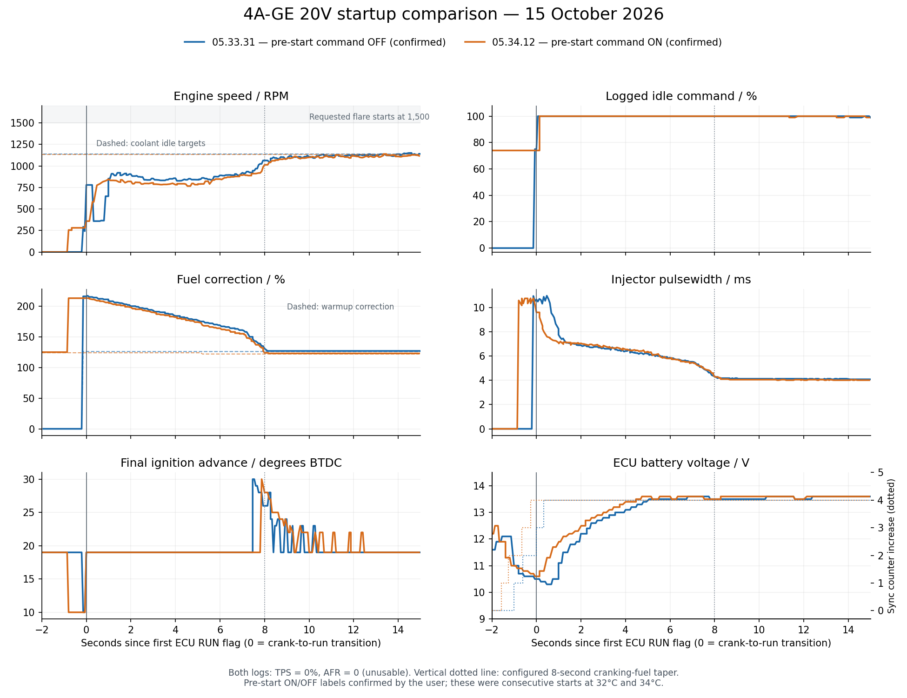

# Startup diagnostics — 15 October 2026

Both logs reproduce a delayed rise to the coolant idle target. Enabling Run before start changes the pre-start idle command but does not produce the requested 1,500–2,000 RPM flare. The important new evidence is that the logged idle command reaches 100% almost immediately after the crank-to-run transition and stays there throughout the low-RPM period. The ECU is therefore not reducing its idle command during that period. Actual valve opening and delivered airflow are not logged.

> **Insight:** A saturated idle command with low RPM calls for verification of delivered airflow and combustion quality before changing PID gains or targets. AFR is zero throughout both captures, so rich versus lean operation cannot be established. Startup sync-counter increments require a trigger trace before attributing the initial RPM fluctuations to engine speed alone. Test in neutral/park with ventilation; stop for fuel leakage or backfiring. Verify measured timing before changing ignition advance.

## Evidence and comparison

Inputs: `DataLogs/2026-10-15_05.33.31.msl`, `DataLogs/2026-10-15_05.34.12.msl`, `CurrentTune.msq`, and `projectCfg/mainController.ini`. Both MSL headers identify Speeduino 2025.01.6. The current tune was saved at 05:34:08 PHT and has Run before start = Yes. Separate tune snapshots for both tests are unavailable; other changes between tests cannot be excluded.

The user confirmed 05.33.31 had Run before start OFF; 05.34.12 is the ON test. The recorded pre-start commands agree with this identification. Time zero is the first sample with the ECU RUN bit set, not the first combustion event or starter release. The initial pre-reset capture snapshot was discarded; duplicate timestamps were preserved. Mean RPM is sample-weighted. Log sampling and held RPM values limit precise event timing.

| Observation | 05.33.31 — confirmed OFF | 05.34.12 — confirmed ON |
|---|---:|---:|
| Coolant at first RUN sample | 32°C | 34°C |
| Idle target at first RUN sample | 1,140 RPM | 1,130 RPM |
| Command before cranking | 0% | 74% |
| Observed cranking command | 75% after update | 74% |
| First logged 100% idle command after RUN | 0.061 s | 0.139 s |
| Mean RPM, 3–5 s after RUN | 840 | 787 |
| RPM range, 3–5 s after RUN | 827–857 | 766–803 |
| First sample at or above 1,000 RPM after RUN | 7.736 s | 8.003 s |
| First sample at or above 1,100 RPM after RUN | 8.400 s | 9.342 s |
| Highest RPM in entire capture | 1,150 | 1,147 |
| Total fuel correction at first RUN sample | 216% | 213% |
| Sync counter at beginning → end | 0 → 4 | 6 → 10 |
| AFR | 0 throughout | 0 throughout |
| TPS | 0% throughout | 0% throughout |

These were consecutive starts with different coolant temperature and prior running history, not independent overnight cold starts. They establish that both recorded starts lack the flare; they do not establish the isolated size or direction of the Run before start effect.

## Findings

**1. Idle output is already at its configured ceiling during the plateau.** Both logs hold 100% command from shortly after RUN through the first eight seconds. Increasing the PID gains, running duty table, or idle target cannot create a higher numeric command while it is saturated. However, 100% logged command does not prove the valve is fully open: wiring, output polarity, both drivers, power supply, valve movement, and bypass plumbing remain unverified. The saved configuration is two outputs, Reverse, 250 Hz, with a 40–100% closed-loop range. These settings must match the actual valve and ECU hardware. Later command falls as temperature and operating conditions change, especially in the second capture; that is not a controlled valve-response test.

**2. Fuel enrichment timing is the strongest calibration lead, but richness is unproven.** Total correction falls from approximately 213–216% toward approximately 123–127%, while RPM recovers near the end of the first eight seconds. Pulsewidth falls from roughly 9.6–10.7 ms at the transition toward roughly 4 ms after settling. These are ECU commands, not AFR measurements. MAP and ignition also change, so the association alone does not prove excess fuel.

The current tune has an 8-second cranking-fuel taper. Firmware applies its residual correction after cranking alongside warmup and afterstart enrichment, with compensation for ASE in the taper calculation. It does not simply stop the cranking correction at the RPM threshold. This explains why the taper deserves investigation. There is a separate 8-second idle-air taper; the two settings have different effects. [Matching fuel-correction source](https://github.com/speeduino/speeduino/blob/202501.6/speeduino/corrections.cpp#L173-L198).

AFR = 0 cannot represent a valid measured mixture. The logged AFR target is not measured AFR, and Gego = 100 does not establish correct fueling. No fuel reduction is justified from these captures alone.

**3. Idle ignition does not rescue the initial low-RPM plateau.** Logged final advance stays at 19° during most of the plateau, then briefly rises toward 28–30° around the recovery. The saved idle-advance activation ceiling is 1,100 RPM. In this firmware, when an idle actuator is configured, idle ignition initially waits until RPM exceeds target minus 200 RPM. That is approximately 940 RPM in the first start and 930 RPM in the second. The activation logic is consistent with the observed late timing intervention. Increasing the idle correction curve does not bypass this initial gate. [Matching idle-advance source](https://github.com/speeduino/speeduino/blob/202501.6/speeduino/corrections.cpp#L792-L835).

**4. Both starts add four sync-loss counts, then stabilize.** The first capture has two increments before the first nonzero logged RPM and two around initial catch, including the 779 → 359 RPM indication. The second adds four counts during acquisition/cranking and has no further increments after first RUN. These are counter increments, not four independently proven ignition interruptions. Full-sync status is recorded as 2 in many affected samples; a brief lost-sync event may fall between samples. Acquisition behavior and an electrical/decoder problem cannot be distinguished from these logs. The absence of continued increments during the established plateau makes ongoing sync loss a weaker explanation for that plateau, while startup acquisition still needs verification.

**5. Battery voltage becomes plausible after the early pre-start samples.** The ECU reports near-zero voltage before vehicle power appears, then approximately 10.3–10.9 V around crank/catch and 13.5–13.6 V once charging settles. Initial 0–0.1 V should not be interpreted as a running-engine battery collapse; USB-only power before key-on is a possible explanation, not confirmed hardware context. Both captures still show low RPM after voltage has recovered. Verify ECU and valve supply against a meter during cranking rather than diagnosing a failed battery from the initial samples. The standard Gbattery channel is a derived value in this INI and should not be treated as the raw injector-voltage correction in Open Time only mode.

**6. The idle-air taper limitation remains real, but is not the demonstrated cause of the plateau.** PWM Closed+Open loop uses the running duty table plus PID after the crank state. It does not apply idleTaperTime in this firmware. PWM Open Loop implements that taper. Since these logs show the combined mode commanding 100%, a switch to open loop or an air-taper change is not the first fix for the present symptom. [Matching idle-control source](https://github.com/speeduino/speeduino/blob/202501.6/speeduino/idle.cpp#L453-L615).

## Resolution sequence

1. Confirm the actual idle-valve model, whether both ECU outputs are wired to compatible drivers, and whether the saved tune matches both tests apart from Run before start. Confirm whether logging began with USB power before key-on.
2. Verify valve supply and motion with the engine stopped, using the ECU's supported output-test procedure. With correct power and wiring, establish which command direction admits more air and inspect the bypass path for sticking or restriction. Do not change polarity or frequency blindly. A controlled stationary test with a functioning wideband should then establish the usable airflow range and whether sufficient headroom exists above the cold idle airflow. Record Idle Up state if available: it is enabled with a 50-percentage-point adder, but its input state is absent from these logs.
3. Restore a valid wideband signal and confirm ECU AFR agrees with the controller display when ready. Record controller model and analog-output calibration. Arrange the next startup capture according to the controller's ready/heater procedure; do not interpret warmup or misfire readings as normal mixture data.
4. Capture a tooth/composite trace through cranking and initial catch. Confirm timing with a light, ECU supply/grounds, and the modified 24−1 distributor signals. Correct an identified trigger fault before calibration trials.
5. Once AFR and airflow are established, test the startup fuel transition one variable at a time at comparable coolant temperatures. If the warmed controller confirms rich, poorly firing operation during the plateau, shorten the cranking-fuel taper first as a controlled comparison while preserving the cranking curve, ASE, WUE, and timing. If it shows lean operation, verify fuel delivery and injector-voltage behavior instead of reducing enrichment. No replacement duration or fuel percentages are assigned without that evidence.
6. After the catch is smooth, implement the requested flare using measured extra airflow followed by decay. Keeping this firmware's combined PWM mode does not provide a separate configured air taper. PWM Open Loop can provide that transition after its duty table and valve range are validated, but loses PID regulation and must be checked through warmup and accessory loads. Do not switch modes while the engine is running. A higher coolant target produces sustained fast idle, not a brief separate flare.

For the next capture, retain RPM, idle command/target, MAP, TPS, final advance, pulsewidth, Gammae, WUE, battery voltage, sync counter/status, and add usable AFR plus available ASE/cranking-correction/Idle Up channels. Record coolant at start, starter release, and wideband readiness. Use a comparable overnight soak for cold-start comparisons.

Calibration files and original logs were not modified. This report, the comparison PNG/SVG, and the machine-readable metrics JSON are the only workspace additions from this analysis.
